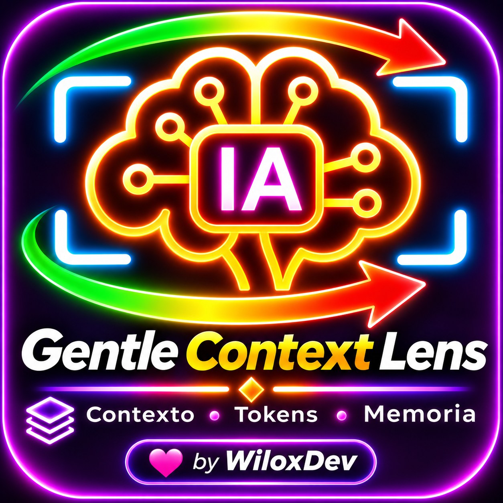

<p align="center">
  
</p>

# Gentle Context Lens

[](https://gentlemanprogramming.com/gentle-hub/)
[](https://bit.ly/48zTJUo)
[](LICENSE)
[](https://pi.dev)

Observabilidad activa y poda quirúrgica del contexto para **Gentle Shell** y **TelarDev**: convierte la ventana de contexto de un visor pasivo a un **optimizador activo de tokens con cero amnesia**.

> 💬 **Comunidad y Soporte:** `wilox2` · [Servidor de Discord Oficial](https://bit.ly/48zTJUo)

---

## 🌟 ¿Qué resuelve Gentle Context Lens?

1. **Fin al "Token Mismatch":** Se sincroniza con la API real y el usage oficial de la sesión en lugar de usar estimaciones heurísticas imprecisas.
2. **Ambient HUD en Tiempo Real:** Olvídate de abrir pantallas gigantes que te sacan del chat. Muestra un semáforo (🟢/🟡/🔴) en la barra de Gentle Shell y un mini widget horizontal permanente en el sidebar de **TelarDev**.
3. **Poda Quirúrgica de Blobs (Anti-Amnesia):** Comprime salidas gigantescas de herramientas y logs viejos en stubs de 1 línea, recuperando hasta 40,000 tokens **sin forzar al agente a compactar ni olvidar instrucciones críticas**.
4. **Métrica "ROI por Token":** Descubre qué herramientas y habilidades pagan su costo en tokens y cuáles consumen espacio sin haberse usado nunca.
5. **Transparencia en Inyecciones:** Agrupa y explica de forma amigable qué es cada bloque inyectado por las extensiones y contratos de seguridad.

---

## 📦 Instalación

### En Gentle Shell
```bash
gentle-shell install git:github.com/WiloxDev/gentle-context-lens
```

### En Pi Puro
```bash
pi install git:github.com/WiloxDev/gentle-context-lens
```

---

## 🚀 Comandos Integrados (`/lens`)

- `/lens` o `/lens status` — Abre la cabina de mando con el semáforo de presión, desglose de memoria en barras ASCII y recomendaciones.
- `/lens roi` — Muestra el ranking de Retorno de Inversión por herramienta (identifica herramientas con 0 usos que drenan tokens).
- `/lens prune` — Ejecuta la poda quirúrgica no destructiva de salidas pesadas y logs antiguos clasificados como `SAFE`.
- `/lens injections` — Inspecciona y explica de manera humana qué inyecta cada extensión, contrato de seguridad y regla local.

---

## 🛡️ Matriz de Seguridad de Poda

| Nivel de Riesgo | Componentes | Acción de Gentle Context Lens |
|---|---|---|
| 🟢 **SAFE TO PRUNE** | Salidas de bash > 800 chars de turnos pasados, diffs superados, logs viejos. | Comprime a stubs de 1 línea preservando el status code. |
| 🟡 **CAUTION** | Herramientas con 0 usos en la sesión actual. | Sugeridas en `/lens roi` para desconexión voluntaria. |
| 🔴 **IMMUTABLE** | `AGENTS.md`, System Prompt base, último turno del usuario. | **Intocable.** Nunca se altera para garantizar cero amnesia. |

---

## 🏷️ Temas de GitHub para Gentle Hub

- `gentle-shell-package`
- `gentle-shell-extension`
- `gentle-hub-project`
- `gentle-shell`
- `telardev`
- `pi-extension`
- `context-lens`

---

## 📄 Licencia

MIT © Wilox. Creado para el ecosistema de Gentle Shell y la comunidad de Gentleman Programming.
